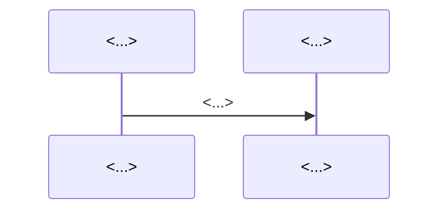

# <Feature / Subsystem> — Design

> **Scope:** <what this design covers, and explicit non-goals>.
> **Reflects:** the code as of <YYYY-MM-DD> (<relevant epics/stories>).
> **Governing:** ADR-<NNNN> (the decision), `<arch>/<slug>.md` (diagrams; the `arch` layout path, docs-layout.md).

## TL;DR

<The end-state design in 3–6 numbered steps — the reader should grasp the whole
shape from this section alone.>

## Context & constraints

<Current state and the problem being solved. Hard constraints that bound the
solution (external contracts, security, correctness invariants, physics). Explicit
non-goals so scope is unambiguous.>

## Theory and gold standards

<The subsystem's nouns: the few kinds of work it does. Each kind has one shape and
one reference module per tier.>

| Kind of work | Tier | Reference (`path:start-end`, or `proposed: ADR-NNNN`) | Shape it fixes |
| --- | --- | --- | --- |
| <noun> | <tier> | <reference> | <what every instance must share> |

<For each shape, a verbatim excerpt of at most 30 lines from the repo; a new shape
is a sketch labeled `proposed`.>

## The design



<Narrative, stage by stage: what drives each stage, where the seams/interfaces
are, what is config-selected (`Kind`/factory), what resiliency is built in, and
what is deliberately deferred.>

### Code generation

<The contracts this design is derived from (proto / OpenAPI / schema / DI graph /
templates), the generator that owns each, where output lands, and the drift check.
"None" is a decision — say why the code can't be generated.>

### Operability

<Per external dependency: timeout, retry policy (transient codes only), circuit
breaker / bulkhead, and the decorator order. The new error codes. The logs,
metrics, and spans added; health/readiness; shutdown and drain. How it degrades.>

### Cross-cutting and rollout

<The layers from `cross-cutting.md` this design reaches, each with its owner stage. The
deploy order, manual steps, version-skew window, and rollback.>

### Configuration

<The config slice each layer owns, the `Kind`s and their stub default, new fields
with their fail-safe `base` values, and what lives in env overlays vs secrets.>

## State / data model

```
<FSM or schema, when the design has stateful entities — e.g. document status:
pending ─▶ processing ─▶ indexed / failed>
```

## Alternatives considered

| Option | Why not chosen |
| --- | --- |
| <alt> | <trade-off> |

## Gaps & Unknowns

Each item names a specific file, system, or decision and ends in a question, a story, or `checked: <evidence>`.

- **Assumptions:** <assumption → how verified>
- **Questions nobody asked:** <question — how the answer changes the design>
- **Failure modes:** <what breaks, and where the design handles it>
- **Case against this design:** <the strongest argument, and the answer to it>
- **Unknown unknowns:** <what was examined outside this subsystem, and what it turned up>

## Open questions

- <unresolved decision that needs a ruling before/while building>

## References

- ADRs: <ADR-NNNN …> · Arch: `<arch>/<slug>.md` · Stories: <…>
