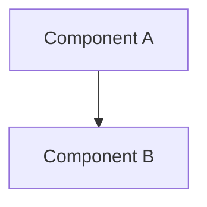

# Epic <N> — <Title>

**Status**: Planning **Stories**: -- **Class**: <highest story class> **Initiative**: <ADR-NNNN, … — or none>
**Design doc**: <`<design>/<slug>.md` — one per epic> **Merged**: -- **Stable**: -- (done = stable in staging, not merged — `~/.claude/templates/estimate.md`)

## Summary

<2-3 sentences describing what this epic achieves and why>

## Architecture Diagram

## Stories

| #   | Story         | File                               |
| --- | ------------- | ---------------------------------- |
| N.1 | <Story title> | [N.1-slug.md](../stories/N.1-slug.md) |
| N.2 | <Story title> | [N.2-slug.md](../stories/N.2-slug.md) |

## Key Changes

- <Major change or deliverable>
- <Major change or deliverable>

## Dependencies

- <Other epics or external requirements>

## Gaps & Unknowns

Each item names a specific file, system, or decision and ends in a question, a story, or `checked: <evidence>`.

- **Assumptions:** <assumption → how verified>
- **Questions nobody asked:** <question — how the answer changes the epic>
- **Missing work:** <what no story covers yet → story N.M, or why it is out>
- **Case against this epic:** <the strongest argument, and the answer to it>

## Soak (Gate-and-soak epics, or any story with Operational surface ≥ 2)

- [ ] Every new cloud call has its permission/grant deployed (IAM, CI token, trust policy)
- [ ] Generated artifacts, lock files, and pinned versions agree across modules and environments
- [ ] Ran in staging with real data for <window> with no follow-up fix → set **Stable**

## Risks

| Risk     | Likelihood   | Impact       | Mitigation     |
| -------- | ------------ | ------------ | -------------- |
| [Risk 1] | Low/Med/High | Low/Med/High | [Mitigation 1] |
