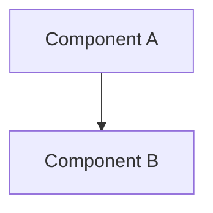

[Back to Epic](<relative link to the epic>)

# Story <N.M> — <Title>

- **Epic**: <N> — <Epic Title>
- **Status**: Todo

## What this delivers

<Two to four full sentences for someone who hasn't read the code. What is wrong or missing today, what is different when this ships, and who notices. Name the product behavior before the module.>

## Story

**As a** <role>, **I want** <capability>, **So that** <benefit>.

**Acceptance Criteria**:

Write each criterion as a complete sentence that a person can read and a test can check. Vague criteria get guessed at.

- Given <state>, when <action>, then <observable result>
- Given <state>, when <action>, then <observable result>
- Given <state>, when <action>, then <observable result>

**Testing**: cover critical-path behavior (coverage is a diagnostic, not a quota — see testing.md). Declare the **tier + double** per behavior — unit mocks the boundary; integration runs the real dependency in a Docker container via testcontainers (name the image), never a fake / in-memory substitute. Tests:

- `test_<scenario_1>` — unit (mock `<boundary>`)
- `test_<scenario_2>` — integration (real `<service>` via testcontainers, e.g. `postgres:16`)
- `test_<scenario_3>`

---

## Planning details

Write each field as a sentence.

- **Size and risk**: <total> of 15, <Delegate | Design first | Gate and soak | Spike>. Decisions <n>, Novelty <n>, Operational surface <n>, Blast radius <n>, Context cost <n>. <One sentence on what drives the score.> (`~/.claude/templates/estimate.md`)
- **Follows**: <the gold standard below, in words and `path:start-end` — or "This story sets a new pattern, decided in ADR-NNNN.">
- **Docs to update**: <every doc this story refreshes: doc comments, test Why/What docs, README, docs pages, CLAUDE.md, ADRs> (`code-addition-checklist.md` 11)
- **Reaches beyond the code**: <the infrastructure, config, or permissions this story touches and the order they roll out — or "Nothing, because <reason>."> (`cross-cutting.md`)
- **Expected size**: <about N hand-written lines; what it deletes; what is generated> (`code-addition-checklist.md` 10)

---

## Gold Standard

The code this story follows, copied verbatim from the repo and never written from memory. One entry per shape, plus a test exemplar. `none (<reason>)` only for a mechanical or config-only story. Code that violates current standards isn't gold. A new pattern is labeled `proposed: ADR-NNNN`.

### <Shape> — `path:start-end` @ `<short sha>`

```<language>
<verbatim excerpt, at most 30 lines>
```

**Copy:** <what must match> · **Vary:** <what changes in this story>

---

## Architecture References

- [ARCH-NNN-<name>.md](../arch/ARCH-NNN-<name>.md)

---

## Architecture Diagram



---

## Proposed Repository Structure

> Fill in **only when this story creates new files.** Omit this section entirely if no files are added.

Show where new files land as a tree relative to the repo root; mark added paths `(new)` and changed paths `(modified)`. The layout MUST be consistent with the current repository structure and the project's language conventions — inspect the real tree first (`codegraph_files` / `ls`; the monorepo standard is `~/.claude/templates/repo.md`). If this story needs a directory or layout that **deviates** from the current structure, STOP and ask the user to confirm before finalizing the story.

```text
src/
├── <area>/
│   ├── <existing_file>        # modified
│   └── <new_file>             # (new)
└── tests/
    └── <area>/
        └── test_<new_file>    # (new)
```

- [ ] Matches the current repository layout
- [ ] Deviates from current layout — described above and **confirmed with the user** (note what/why)

---

## Checklist

The implementer's definition of done. A reader who only wants to know what this story does can stop above this line.

### Architecture — the One Idea (behind an interface, selected by config, injected explicitly, wrapped by decorators)

- [ ] **Core interface** — the contract lives in the dependency-free core; consumers depend on it (accept interfaces, return structs)
- [ ] **Factory** — `Kind` + frozen `Config` + `*_from_config` / `NewFromConfig` returns the interface; default kind is a stub/noop; an unknown kind fails loudly; each backend in its own package, heavy deps lazy-imported
- [ ] **Dependency injection** — constructor injection only, wired at the composition root (Go: Wire provider set → generated `wire_gen.go`; Python: `deps.py`); no I/O during construction; no globals, singletons, or service locators — lifetimes are owned by the root, torn down in reverse order
- [ ] **Stub-first** — the whole graph builds against stubs with zero I/O
- [ ] **Decorators** — timeout, retry (backoff + jitter, transient only), circuit breaker, tracing, metrics, logging wrap the interface at the composition root in the per-layer order; never inlined in a backend
- [ ] **Coded errors** — every error wraps with a code (transient/permanent and transport status derive from it); sanitized at the transport edge
- [ ] **Patterns over helpers** — Strategy / Adapter / Repository / Pipeline stage; DRY = push logic down into the shared library, inject product strategy up
- [ ] **Follows the gold standard** — matches every *Copy* item; a departure is recorded with its reason

### Config

- [ ] New settings live in the owning layer's typed config slice, validated before startup
- [ ] Layered: fail-safe `base` default (selects stubs, no account IDs) → env overlay → gitignored secrets; env vars override YAML
- [ ] No env/config reads outside the config layer or entrypoints
- [ ] Every field documented (description / doc comment); config reference docs regenerated if the project generates them

### Code Generation

- [ ] Contract-derived code (proto, OpenAPI, schema, DI graph, mocks, enums) changed at its source and regenerated via the project CLI — no hand edits to generated files
- [ ] Generated output committed; drift check passes
- [ ] A repeated shape is a scaffold/template, not copy-paste

### Observability & Resilience

- [ ] Every external call has a chosen timeout
- [ ] Structured logs (context-carrying, trace-correlated), metrics, and spans on the new paths
- [ ] Health/readiness and graceful shutdown cover any new long-lived resource
- [ ] Failure modes named (idempotency, DLQ, degradation) where the story crosses a network or queue

### Testing Requirements

- [ ] Critical-path behavior covered (no numeric quota — see testing.md)
- [ ] Right double per tier: unit mocks the boundary; integration uses testcontainers (real dep in Docker) — no fakes / in-memory substitutes
- [ ] Organized test structure with descriptive names
- [ ] Every test documents: **Why important** + **What it tests**
- [ ] Shared test fixtures and helpers (see language standards)
- [ ] Edge cases covered and documented

### Documentation Requirements

- [ ] Module/package-level documentation on all files
- [ ] Every symbol documented — types, functions, methods, struct fields / attributes, enum values (trivially obvious fields exempt)
- [ ] Inline comments for non-obvious logic only
- [ ] Type annotations on all public APIs
- [ ] Architecture diagram updated (if structural change)
- [ ] README in implementation directory (if new)

### Completion Workflow

- [ ] All checklist items above are satisfied
- [ ] Fast checks pass (format, lint, type check, affected tests)
- [ ] One commit for this story, conventional message (the full gate runs once per epic, after the last commit)
- [ ] Update story status from "Todo" to "Complete" (handled by `/spec-verify`)
